# Как пользоваться GAP Smart Tool

Коротко: всё, что умеет приложение, и куда нажимать. Установка — в [INSTALL.md](INSTALL.md).

**Главное.** После принятия условий приложение работает в фоне с каждого включения машины. Кнопка руля и голос
работают и при закрытом приложении —
открывать приложение нужно только чтобы что-то настроить или нажать на экране.

- [Первое открытие](#первое-открытие)
- [Меню слева](#меню-слева)
- [Климат](#климат)
- [Машина](#машина)
- [Android Auto](#android-auto)
- [Настройки](#настройки)
  - [Кнопка руля](#кнопка-руля)
  - [Голос](#голос)
  - [Звук](#звук)
  - [Комплектация](#комплектация)
  - [Wi-Fi и Bluetooth](#wi-fi-и-bluetooth)
  - [Приложение](#приложение)
  - [Обновление](#обновление)
  - [Диагностические данные](#диагностические-данные)
  - [Настройки Android](#настройки-android)
  - [Условия](#условия)
- [За рулём](#за-рулём)
- [Если что-то не так](#если-что-то-не-так)

---

## Первое открытие

После заставки — условия использования. Прочитайте и нажмите **«Принимаю условия»**.

- **«Не сейчас»** — приложение не будет управлять машиной. Передумаете — откройте приложение снова.
- Перечитать условия или отозвать согласие — **«Настройки»** → **«Условия»**.

---

## Меню слева

- **Климат**, **Машина**, **Android Auto**, **Настройки** — четыре раздела приложения. Меню всегда на месте, раздел
  открывается справа от него.
- **«Поддержать»** — QR-код для добровольной поддержки автора: наведите камеру телефона — откроется страница с
  номером карты для перевода. Ни на что в приложении не влияет.
- Под ним — **часы с датой** и **версия** приложения.
- **«нет связи»** (красная метка) — приложение не получает данных от машины. Всё, что требует машины, бледное и не
  нажимается.

Горящая золотом кнопка — включено. Цвет приложения следует теме приборной панели.

---

## Климат

1. **Кнопки климата** — климат вкл/выкл, «Зима», AUTO, A/C, MAX, рециркуляция, обдув лобового, обогрев заднего
   стекла (зеркала греются вместе с ним), Sync — температура пассажира повторяет водителя.
   **«Зима»** включает разом подогрев руля, подогрев сиденья водителя на 2 и обогрев заднего стекла. Если руль и
   стекло уже греются, а сиденье — на 2, выключает всё это; иначе включает недостающее.
2. **Температура водителя** — «+» и «−», шаг 0,5°, или ведите ползунок рядом. Справа — то же для пассажира.
3. **Направление обдува** — нажмите на нужный поток у фигуры: на стекло, в лицо, в ноги, в лицо и ноги или в ноги и стекло.
4. **Скорость обдува** — нажмите на нужное деление.
5. **Подогревы** — сиденье водителя, руль, справа — сиденье пассажира. Каждое нажатие на сиденье — следующий
   уровень (выкл → 1 → 2 → выкл), руль — вкл/выкл. Есть вентиляция сидений — рядом появятся и её кнопки
   (выкл → 1 → 2 → 3 → выкл).

Всё, что включено, видно сразу: приложение читает состояние машины.

---

## Машина

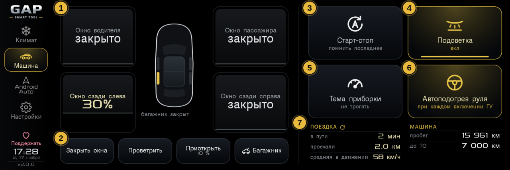

1. **Окна** — насколько открыто каждое окно. Это только показ — сами окна открываются кнопками на двери.
2. **Действия:**
   - **«Закрыть окна»** — закрыть все окна.
   - **«Проветрить»** — приоткрыть все окна на 10 %. Только на стоянке (P).
   - **«Приоткрыть»** — щель окну водителя, можно и на ходу. Под кнопкой — на сколько. Чтобы поменять,
     удерживайте кнопку: от 5 до 30 %.
   - **«Багажник»** — открыть (приложение переспросит) или закрыть. Только на стоянке (P).
3. **Старт-стоп** — режим системы старт-стоп (ниже).
4. **Подсветка** — атмосферная подсветка и её цвет (ниже).
5. **Тема приборки** — цвет приборной панели (ниже).
6. **Автоподогрев руля** — нажмите, чтобы подогрев руля включался при каждом включении ГУ. Ещё раз — выключить.
7. **Поездка** — сколько в пути (без стоянок в P), сколько проехали и средняя скорость в движении (стоянки её не
   занижают). Поездка — от включения зажигания до выключения, начинается с первого выезда из P. Чтобы начать её
   заново, нажмите на неё
   (значок ↻ у заголовка) — приложение переспросит. Рядом — **пробег** и **сколько осталось до ТО**.

Удержание «Приоткрыть» — размер щели:

«Багажник» — приложение переспросит:

### Старт-стоп

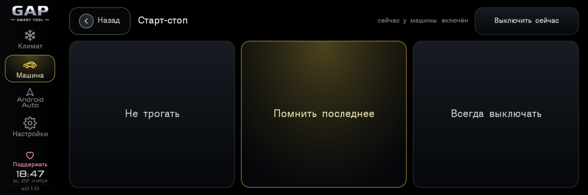

- **«Не трогать»** — как решает машина.
- **«Помнить последнее»** — при включении ГУ вернёт, как было в конце прошлой поездки.
- **«Всегда выключать»** — выключит, как только машина его включит, в том числе при каждом запуске двигателя.

Справа вверху — что сейчас у машины, и кнопка, чтобы выключить или включить старт-стоп прямо сейчас.

### Подсветка

- **«Подсветка»** вверху — включить или выключить.
- **Цвет** — нажмите на квадрат, 42 цвета, как в штатных настройках.
- **«По режиму вождения»** — цвет меняется вместе с режимом.

Яркость — в штатных настройках машины.

### Тема приборки

- **«Не трогать»** — приложение тему не меняет.
- **«По режиму вождения»** — как с завода: комфорт — золотая, эко — синяя, спорт — красная.
- **Синяя**, **Красная**, **Золотая** — одна тема при любом режиме.

Справа вверху — какая тема сейчас.

---

## Android Auto

Android Auto с телефона — прямо в приложении, справа от меню, без штатного QDLink и без проводов. На телефоне нужно
приложение [OvertakeLink](https://github.com/queryParams/OvertakeLink) версии 1.0.0 или новее.

1. **Что сейчас** — ждём телефон, запускаем Android Auto, связь пропала и т. п.
2. **Как подключить:**
   1. Включите на телефоне точку доступа.
   2. Подключите к ней ГУ: в GAP «Настройки» → «Wi-Fi».
   3. В OvertakeLink: «Настройки» → «В GAP Smart Tool по Wi-Fi».
3. **«Остановить попытки»** — приложение перестанет искать телефон; **«Подключиться»** — снова искать. Работавшее
   подключение оборвалось и не вернулось за 5 минут — попытки останавливаются сами.
4. **Цепочка подключения** — Wi-Fi ГУ → OvertakeLink → Android Auto. Красное — где оборвалось, под ним — что
   проверить. «Связь с телефоном обрывается» — телефон отвечает, но подключение не держится: обновите OvertakeLink,
   а если на телефоне VPN — выключите его.

Когда всё подключится, вместо этого экрана — Android Auto. Он остаётся открытым, пока вы переходите в другие
разделы: вернулись — картинка сразу. Связь пропала — приложение переподключается само; не вернулась за 5 минут —
перестаёт (см. п. 3).

---

## Настройки

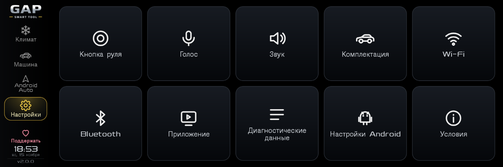

Все настройки приложения — плитками. Внутри каждой **«Назад»** слева вверху возвращает к плиткам.

### Кнопка руля

Пустая кнопка на руле получает три действия: **короткое нажатие**, **двойное** и **удержание** (0,7 с).

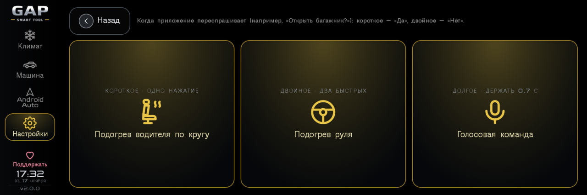

Нажмите на плитку жеста — откроется выбор действия:

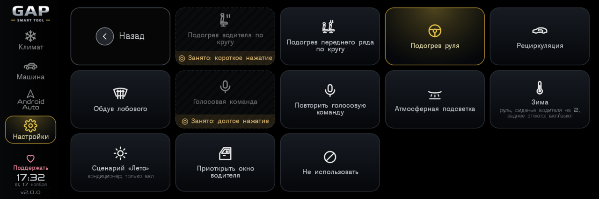

Подогрев водителя или всего переднего ряда по кругу (1 → 2 → выкл), вентиляция водителя по кругу (если она есть),
подогрев руля, рециркуляция, обдув лобового, **голосовая команда**, повтор последней голосовой команды, подсветка,
«Зима», «Лето», «Приоткрыть окно водителя» или «Не использовать».

- Одно действие — на один жест. Занятое другим жестом подписано **«Занято: …»** — если выбрать его, оно
  перенесётся сюда.
- **«Зима»** — подогрев руля, сиденья водителя на 2 и заднего стекла; включает недостающее разом, а если руль и стекло
  уже греются, а сиденье — на 2, выключает всё это.
- **«Лето»** — кондиционер, а если есть вентиляция сидений — ещё и вентиляция сиденья водителя на 2. Только
  включает, не выключает.
- **Когда приложение переспрашивает** (например, «Открыть багажник?»), кнопка только отвечает: короткое нажатие — «Да», двойное — «Нет».
  Назначенное действие в этот момент не срабатывает.

Чего нет в комплектации машины, того нет и в списке.

### Голос

**Как сказать команду.** Нажмите жест, на который назначена «Голосовая команда» (по умолчанию — **удержание**
пустой кнопки), и говорите сразу после сигнала — коротко: «подогрев руля», «обдув на три», «мне холодно».
Интернет не нужен — речь распознаётся прямо в машине.

Пока приложение слушает и отвечает, музыка становится тише — так же, как под подсказку навигатора. Насколько тише —
штатная настройка звука навигации в машине.

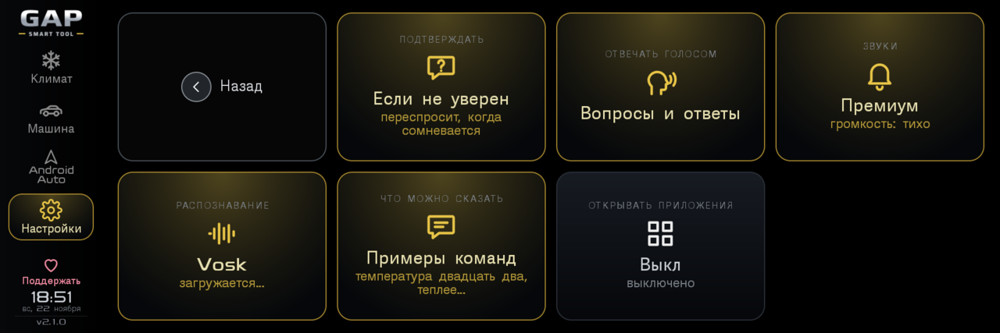

- **Подтверждать** — когда переспрашивать: «Если не уверен» (лучше всего), «Всегда» или «Только важные». Важные
  команды (выключить климат, рециркуляция, все подогревы и т. п.) при сомнении переспрашиваются в любом режиме, а
  открыть багажник — всегда, даже без сомнения. Ответить можно и голосом, если на удержание кнопки назначена
  голосовая команда: удержите кнопку и скажите «да» или «нет».
- **Отвечать голосом** — вопросы и ответы, только вопросы или выключено (только звуки).
- **Звуки** — сигналы приложения (ниже).
- **Распознавание** — какая модель слушает речь (ниже). Сразу после запуска ГУ модель загружается
  (обычно 10–25 секунд) — плитка пишет «загружается…».
- **Примеры команд** — что можно сказать, по темам.
- **Открывать приложения** — «запусти приложение навигатор», «запусти приложение ютуб». По умолчанию выключено.
  Говорите обязательно со словом «приложение». Короткие иностранные названия (2ГИС, Waze) распознаются хуже —
  их лучше открывать с экрана.

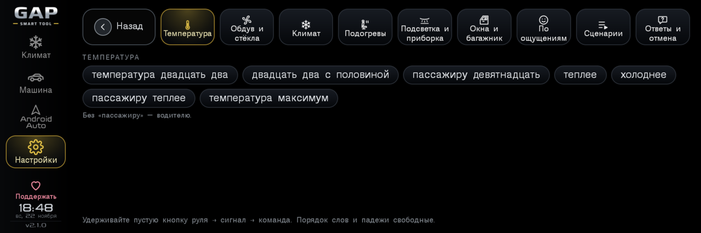

Команды разбиты по темам: температура, обдув и стёкла, климат, подогревы, подсветка и приборка, окна и багажник,
по ощущениям («мне холодно», «душно», «запотело лобовое»), ответы и отмена. Порядок слов и падежи — любые.

**«Отмена»** или **«верни обратно»** после команды машине — вернуть как было. Багажник так не вернуть, а окна
обратно открываются только на стоянке (P).

Цвет подсветки называйте вместе со словом «подсветка»: «подсветка синяя», «цвет подсветки пурпурный». Если цвет не
расслышан, приложение переспросит, а не выключит подсветку.

#### Звуки

17 наборов сигналов и «Без звука». Нажмите на набор — он выберется и прозвучит; ▶ — только послушать. Вверху —
громкость: тихо, средне или громко. Сигналы и ответы звучат с громкостью музыки. Пока голос говорит или слушает,
кнопки громкости показывают плашку «导航音量» (громкость навигации) — на голос и музыку она не влияет.

#### Модели распознавания

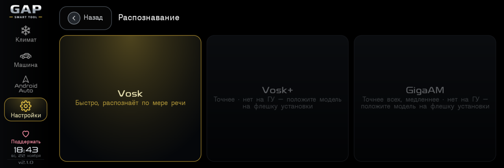

| | Vosk | Vosk+ | GigaAM |
|---|---|---|---|
| Точность | ошибается чаще | точнее | самая точная |
| Ответ после фразы | сразу, текст виден по ходу речи | около 1 с | 2–5 с |
| Загрузка при выборе и при запуске ГУ | около 20 с | около 25 с | около 10 с |
| Память ГУ | меньше всех | больше | больше всех |
| Где взять | встроена | архив моделей, см. [INSTALL.md](INSTALL.md#модели-распознавания-по-желанию) | то же |

- **В памяти — только выбранная модель.** Переключились — прежняя выгружается, новая загружается.
- **С Vosk на Vosk+ или GigaAM** — пока новая загружается, слушает Vosk. **Между Vosk+ и GigaAM или обратно на
  Vosk** — на время загрузки голос не отвечает: «Голос переключается на другую модель — подождите».
- **Пока модель загружается, другую не выбрать** — загрузка дойдёт до конца.
- **С Vosk+ и GigaAM** во время речи на плашке «Слушаю…» без текста — фраза разбирается целиком, когда вы её
  закончите («Распознаю…»).
- **Модели нет в машине** — её плитка бледная с подсказкой «положите модель на флешку установки». Не загрузилась
  (не хватило памяти, сбой) — приложение само перейдёт на Vosk и напишет об этом.
- Совет: **Vosk+** — точнее Vosk и почти так же быстро. GigaAM — когда точность важнее скорости ответа.

#### Переспрос

Если команда понята неуверенно, сверху появится вопрос (как на картинке с багажником выше):

- **Да** — нажмите кнопку руля один раз, нажмите на экране или удержите кнопку и скажите «да» (если на удержание
  назначена голосовая команда).
- **Нет** — нажмите кнопку руля два раза, нажмите на экране или удержите кнопку и скажите «нет».
- Полоска внизу — 8 секунд; не ответили — команда отменяется.
- Пока висит вопрос, кнопка руля только отвечает — своё действие не выполняет.

### Звук

1. **Профиль** — «Как штатно» (бас, сцена, плотность и эквалайзер выключены), «Тихо и чётко», «Насыщенный» или «Для трассы». Выбранный профиль
   светится.
2. **«Свой»** загорается, когда бас, сцена, плотность или эквалайзер не совпадают ни с одним профилем. **«Сбросить»** — звук как штатно и тонкомпенсация
   выключена.
3. **Эквалайзер** — 5 полос, от низких к высоким, ±6 дБ: «+» и «−» или ползунок.
4. **Бас, объём сцены, плотность** — ползунками. «Плотность» делает тихие места громче, звук — плотнее.
5. **Тонкомпенсация** — полнее звук на тихой громкости. Работает в самом усилителе, для всех источников, включая
   радио. Три кнопки:
   - **«Выкл»**.
   - **«Вкл»** — включить. Штатный усилитель сам выключает тонкомпенсацию, когда прибавляют громкость, — так устроена
     прошивка машины, приложение на это не влияет. Поэтому после прибавки громкости приложение переключает кнопку на
     «Выкл»: чтобы не было видимости, что тонкомпенсация включена, когда на деле её уже нет.
   - **«Держать»** — после каждой смены громкости приложение снова отправляет усилителю команду «включить». Нюансы:
     каждый поворот громкости — лишняя команда машине (небольшая нагрузка), и в момент смены громкости может быть
     слышен короткий перепад звука, пока тонкомпенсация не вернётся (около секунды).
6. **Громкость по скорости** — выкл, низкая, средняя или высокая: насколько машина прибавляет звук с ростом
   скорости. Это штатная настройка машины — то же, что в штатных настройках звука. В машине пока не проверено:
   если звук не меняется, пользуйтесь штатными настройками.

Бас, сцена, плотность и эквалайзер действуют на весь звук, который идёт через Android (музыка по Bluetooth, с
флешки, из приложений), на радио — нет. Они работают и
при закрытом приложении; «Как штатно» выключает их, тонкомпенсацию и громкость
по скорости не трогает.

### Комплектация

Что есть в машине: подогрев и вентиляция сидений, подогрев руля, атмосферная подсветка, старт-стоп,
электробагажник.

- **«Автоматически»** — приложение берёт это из заводских настроек ГУ.
- **«Вручную»** — если определилось неверно. Нажмите на плитку — она переключится, и приложение перейдёт на
  «Вручную».

Чего нет, то приложение прячет и не включает: ни с экрана, ни кнопкой руля, ни голосом.

### Wi-Fi и Bluetooth

**Wi-Fi** — подключить машину к интернету с телефона без штатных настроек Android: раздайте интернет с телефона и
выберите сеть.

- Сверху — Wi-Fi вкл/выкл и **«При запуске ГУ»**: «Не трогать», «Помнить последнее» (по умолчанию) или «Всегда
  включать». Прошивка ГУ при запуске иногда оставляет Wi-Fi выключенным — приложение вернёт его и скажет об этом.

- Связь с сохранённой сетью держится сама: пропала — приложение подключится снова (если вы не нажали «Отключиться» в GAP).
- Ниже — сети. Нажмите на сохранённую — «Подключиться», «Отключиться» или «Забыть сеть». Новая сеть с паролем —
  своя крупная клавиатура; пароль вводится только на стоянке (P).

**Bluetooth** — телефон для звонков и музыки.

- Сверху — Bluetooth вкл/выкл, как ГУ видно телефонам, «Найти» и **«При запуске ГУ»** — как у Wi-Fi.
- Музыка по Bluetooth держится сама: телефон подключился только для звонков — приложение подключит и музыку
  (если музыка не подключена к другому телефону и вы сами не отключили её этому телефону в GAP).
- Ниже — устройства. Нажмите на сопряжённое — «Звонки» и «Музыка», «Подключить», «Отключить» или «Забыть
  устройство». Новое устройство сопрягается только на стоянке (P).

### Приложение

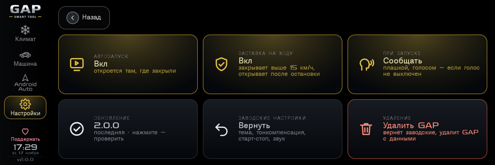

- **Автозапуск** — открывать приложение при включении ГУ там, где вы его закрыли.
- **Заставка на ходу** — закрывать экран выше 15 км/ч (см. [За рулём](#за-рулём)). Отключить можно только на
  стоянке, через предупреждение.
- **При запуске** — когда приложение запустилось, показать плашку «GAP Smart Tool готов» и сказать «Приложение
  готово» (голосом — если голосовые ответы не выключены).
- **Обновление** — версия приложения и обновление по воздуху (ниже).
- **Заводские настройки** — **«Вернуть»**: тема приборки — «по режиму вождения», тонкомпенсация — выключить,
  звук — «как штатно», старт-стоп — «не трогать». Подсветка остаётся как есть. Нажмите, если что-то пошло не так;
  без связи с машиной ничего не меняется.
- **Удалить GAP** — удалить приложение прямо с экрана, без флешки. Только на стоянке (P). Приложение вернёт заводские
  настройки машины, затем появится системный вопрос «Удалить приложение?» — после «ОК» Android удалит приложение со
  всеми файлами: настройками, журналами, моделями распознавания. Пока заводские возвращаются, экран закрыт чёрной
  заставкой «Возвращаем заводские настройки…» — не выключайте зажигание и не выходите из приложения. Нет связи с
  машиной — приложение предупредит, что заводские не вернутся, и предложит «Удалить без заводских».

### Обновление

Нужен интернет — например, Wi-Fi с телефона. Раз в сутки приложение проверяет, нет ли новой версии; нажать на
плитку **«Обновление»** — проверить сейчас.

- Есть новая версия — на **«Настройках»** и **«Приложении»** загорится золотая точка. Откройте **«Обновление»**:
  там «что нового» и **«Скачать»**.
- Скачивается и при закрытом приложении. Оборвалось (пропал интернет, выключили машину) — продолжится с того же
  места.
- Скачалось — на странице **«Обновление»** появится **«Установить»**. Если окно GAP закрыто, на стоянке сверху
  появится плашка «GAP Smart Tool … скачан» с той же кнопкой — поверх других приложений.
- Ставится только на стоянке (P) и только по нажатию **«Установить»** — штатным установщиком Android. В первый раз
  Android попросит разрешить «Неизвестные источники».
- Настройки сохраняются. Файл обновления удаляется после установки.

### Диагностические данные

Если что-то работает не так: вставьте флешку, нажмите **«Сохранить на флешку»** и подождите пару секунд.
Журнал появится на флешке в папке `gaptool_…` — где именно, приложение покажет на экране (обычно
`Android/data/io.github.queryparams.gaptool/files/`). Приложите эту папку к обращению.

Под кнопкой — что сейчас со звуком: играет ли музыка, громкость, Bluetooth и какие эффекты работают. Ниже — лента
событий: что приложение делало и что отвечала машина.

Журнал хранится во внутренней памяти приложения — другие приложения его не читают, наружу он попадает только этой
кнопкой или флешкой установки или удаления. В журнале есть и текст распознанных команд; записи голоса приложение не
сохраняет.

### Настройки Android

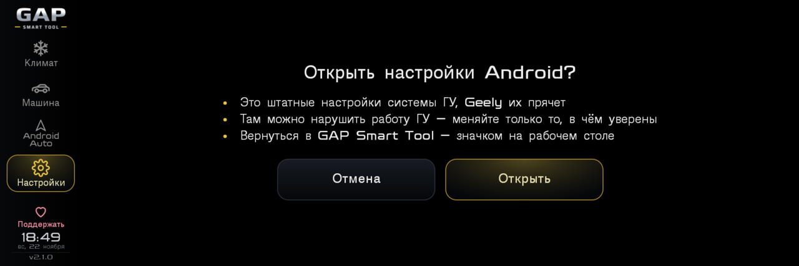

Штатные настройки системы ГУ, которые Geely прячет. Там можно нарушить работу ГУ — меняйте только то, в чём
уверены. Вернуться — значком GAP Smart Tool на рабочем столе.

### Условия

Перечитать условия использования. **«Отозвать согласие»** справа вверху (нажать дважды — второй раз подтверждает) —
приложение перестанет управлять машиной.

---

## За рулём

Выше 15 км/ч экран управления закрывается — чтобы не отвлекаться (выключается в «Настройки» → «Приложение»):

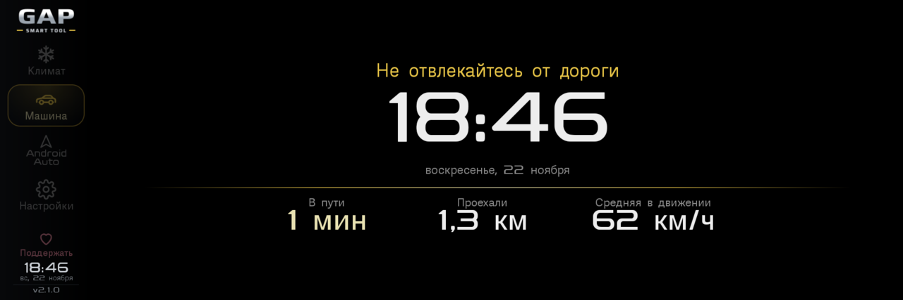

Видно часы, дату и поездку: сколько в пути, сколько проехали, средняя скорость в движении. Касания ничего не
нажимают. Управлять — голосом и кнопкой руля. Полностью остановились или селектор в **P** — экран снова открыт.

- **Android Auto на ходу остаётся открытым**, если его картинка уже идёт: он сделан для езды. В меню на ходу
  нажимается только он.
- **Экран подключения Android Auto** на ходу закрыт заставкой — подключайте телефон на стоянке.

---

## Если что-то не так

- **Голос не слышит** — проверьте, что на нужный жест назначена «Голосовая команда» («Настройки» → «Кнопка руля»).
- **Голос часто ошибается** — поставьте модель Vosk+ или GigaAM («Настройки» → «Голос» → «Распознавание»).
- **Всё бледное, «нет связи»** — приложение не получает данных от машины. Не прошло само через минуту — сохраните
  журнал и напишите в Issues.
- **Ничего не работает** — откройте приложение: возможно, не приняты условия использования (после обновления
  их нужно принять заново, если они изменились) или прошивка ГУ не та — тогда приложение покажет это.
- **Не помогло** — сохраните журнал на флешку и откройте обращение в [Issues](../../issues/new/choose).

**GAP Smart Tool бесплатный.** Скачивать — только здесь, в [Releases](../../releases). Если вам установили его за
деньги — вы платили за работу установщика, а не за приложение.
