# Как пользоваться GAP Smart Tool

Всё, что умеет приложение, и куда нажимать. Описана версия 2.1.0. Установка — в [INSTALL.md](INSTALL.md).

**Главное.** После того как вы примете условия, приложение само работает в фоне с каждого включения машины. Кнопка
руля, голос и сценарии работают и при закрытом приложении. Открывать его нужно, только чтобы что-то настроить или
нажать на экране.

- [Первое открытие](#первое-открытие)
- [Меню слева](#меню-слева)
- [Климат](#климат)
- [Машина](#машина)
- [Android Auto](#android-auto)
- [Настройки](#настройки)
  - [Кнопка руля](#кнопка-руля)
  - [Сценарии](#сценарии)
  - [Голос](#голос)
  - [Звук](#звук)
  - [Комплектация](#комплектация)
  - [Wi-Fi](#wi-fi)
  - [Bluetooth](#bluetooth)
  - [Приложение](#приложение)
  - [Обновление](#обновление)
  - [Диагностические данные](#диагностические-данные)
  - [Настройки Android](#настройки-android)
  - [Дата и время](#дата-и-время)
  - [Условия](#условия)
- [За рулём](#за-рулём)
- [Если что-то не так](#если-что-то-не-так)

---

## Первое открытие

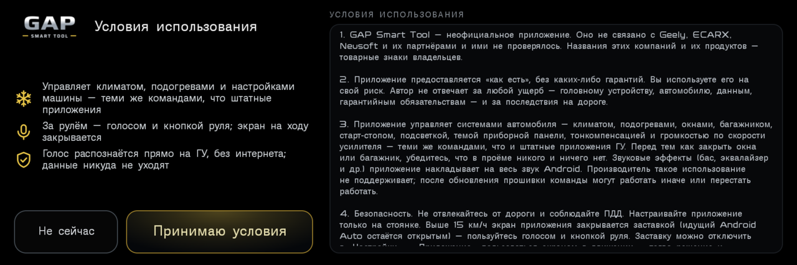

После заставки появятся условия использования. Прочитайте их и нажмите **«Принимаю условия»**.

- **«Не сейчас»** — приложение не будет управлять машиной. Передумаете — нажмите **«Вернуться к условиям»**.
- Перечитать условия или отозвать согласие можно в **«Настройки»** → **«Условия»**.

---

## Меню слева

- **Климат**, **Машина**, **Android Auto**, **Настройки** — четыре раздела. Меню всегда на месте, раздел открывается
  справа от него. Нажали на раздел, когда вы уже внутри него (например, в «Настройки» → «Звук»), — вернётесь в его
  начало.
- **«Поддержать»** — QR-код для добровольной поддержки автора. Наведите камеру телефона — откроется страница с
  номером карты. На работу приложения не влияет.
- Ниже — **часы с датой** и **версия** приложения.
- **«нет связи»** (красная метка вместо часов) — приложение не получает данных от машины. Команды машине становятся
  бледными и не нажимаются.

Выделенная цветом кнопка — значит, включено. Цвет приложения (золотой, синий или красный) меняется вместе с темой
приборной панели.

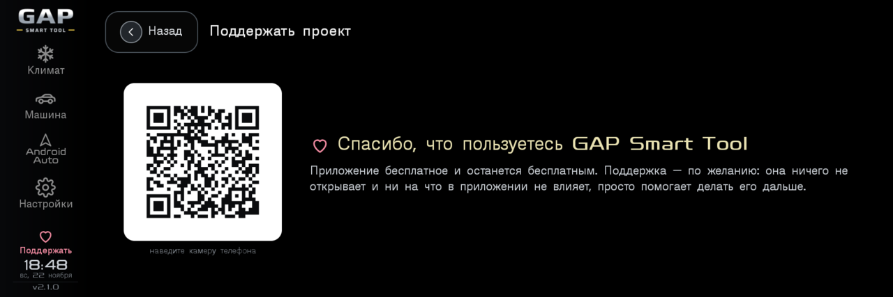

---

## Климат

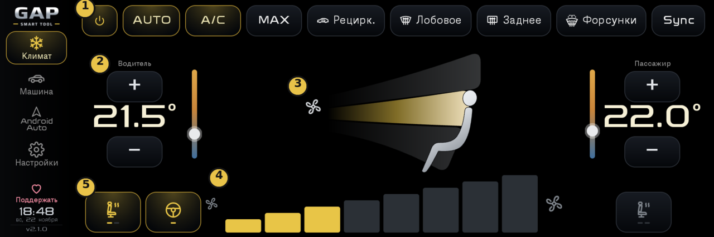

1. **Кнопки климата** — климат вкл/выкл, AUTO, A/C, MAX, рециркуляция, обдув лобового, обогрев заднего стекла
   (зеркала греются вместе с ним), **«Форсунки»** — подогрев форсунок омывателя (если он есть в машине), Sync —
   температура пассажира как у водителя (при двухзонном климате).
2. **Температура водителя** — «+» и «−» с шагом 0,5° или ползунок рядом. Справа — то же для пассажира (при
   двухзонном климате).
3. **Направление обдува** — у фигуры три потока: на стекло, в лицо, в ноги. Нажатие включает или выключает поток.
   Вместе можно включить лицо и ноги или ноги и стекло.
4. **Скорость обдува** — нажмите на нужное деление.
5. **Подогревы** — сиденье водителя, руль, справа — сиденье пассажира. Сиденье: каждое нажатие — следующий уровень
   (выкл → 1 → 2 → выкл), руль — вкл/выкл. Если есть вентиляция сидений, рядом появятся и её кнопки
   (выкл → 1 → 2 → 3 → выкл).

Экран всегда показывает, что сейчас включено в машине.

«Зима» (подогрев руля, сиденья водителя, заднего стекла и форсунок разом) — на [кнопке руля](#кнопка-руля) и голосом
(«включи зиму»). В [сценарии](#сценарии) те же подогревы добавляются по отдельности.

---

## Машина

1. **Окна** — насколько открыто каждое окно. Здесь только показ: сами окна открываются кнопками на двери.
2. **Действия:**
   - **«Закрыть окна»** — закрыть все окна.
   - **«Проветрить»** — приоткрыть все окна на 10 %. Только на стоянке (P).
   - **«Приоткрыть»** — щель в окне водителя, можно и на ходу. Под кнопкой написано, на сколько. Чтобы поменять,
     удерживайте кнопку: от 5 до 30 %.
   - **«Багажник»** — открыть (приложение переспросит) или закрыть. Только на стоянке (P).
3. **Тема приборки** — цвет приборной панели (ниже).
4. **Подсветка** — атмосферная подсветка и её цвет (ниже).
5. **Старт-стоп** — что делать с системой старт-стоп (ниже).
6. **Поездка** — сколько в пути (без стоянок в P), сколько проехали и средняя скорость в движении. Поездка идёт от
   включения зажигания до выключения и начинается с первого выезда из P. Начать её заново — нажмите на неё (значок ↻),
   приложение переспросит. Справа — **пробег** и **сколько осталось до ТО**.

Удержание «Приоткрыть» — размер щели:

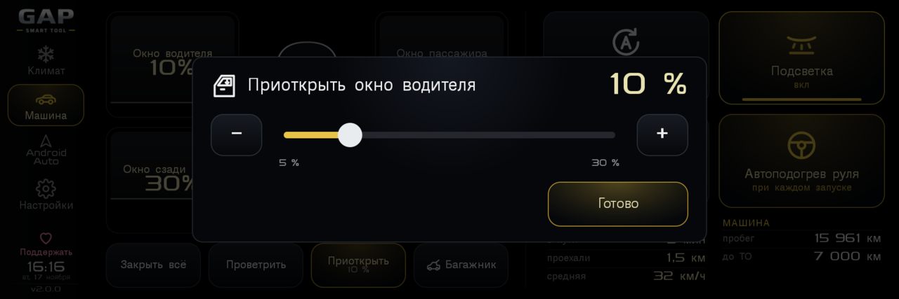

«Багажник» — приложение переспросит:

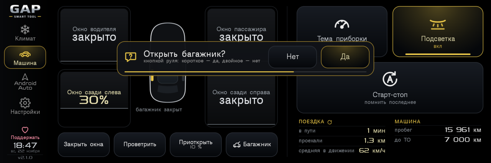

### Тема приборки

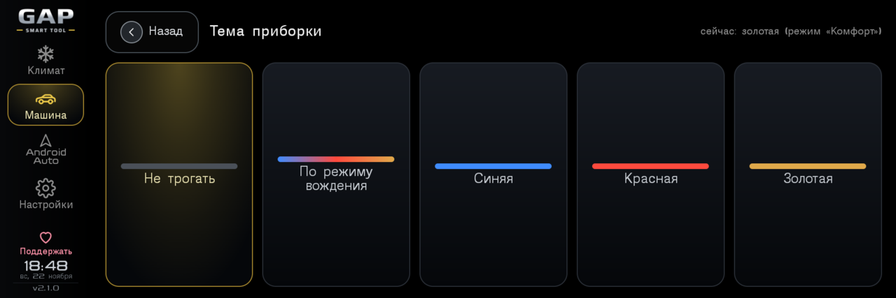

- **«Не трогать»** — приложение тему не меняет.
- **«По режиму вождения»** — как с завода: комфорт — золотая, эко — синяя, спорт — красная.
- **Синяя**, **Красная**, **Золотая** — одна тема при любом режиме.

Справа вверху написано, какая тема сейчас.

### Подсветка

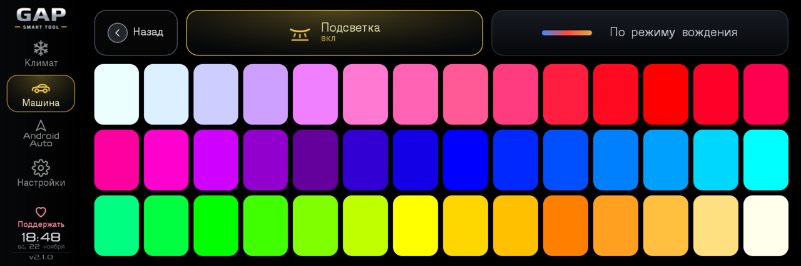

- **«Подсветка»** вверху — включить или выключить.
- **Цвет** — нажмите на квадрат. 42 цвета, как в штатных настройках.
- **«По режиму вождения»** — цвет меняется вместе с режимом.

Если подсветка была выключена, выбор цвета или «По режиму вождения» сразу её включит.

Яркость — в штатных настройках машины.

### Старт-стоп

- **«Не трогать»** — как решит машина.
- **«Помнить последнее»** — при включении ГУ вернёт, как было в конце прошлой поездки.
- **«Всегда выключать»** — выключит, как только машина его включит, в том числе при каждом запуске двигателя.

Справа вверху — что сейчас у машины и кнопка, чтобы выключить или включить старт-стоп прямо сейчас.

---

## Android Auto

Android Auto с телефона — прямо в приложении, справа от меню. Без штатного QDLink и без проводов. На телефоне нужно
приложение [OvertakeLink](https://github.com/queryParams/OvertakeLink) версии **1.3.0 или новее** (более старые с
GAP 2.1.0 не соединятся).

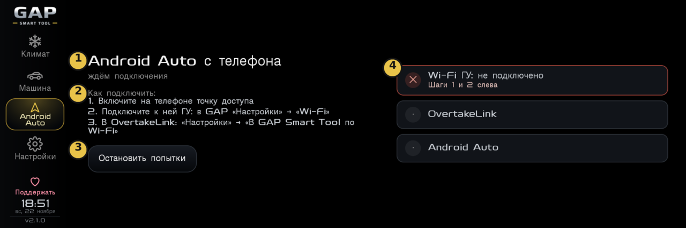

1. **Что сейчас** — ждём телефон, запускаем Android Auto, связь пропала и т. п.
2. **Как подключить:**
   1. Включите на телефоне точку доступа.
   2. Подключите к ней ГУ: в GAP «Настройки» → «Wi-Fi».
   3. В OvertakeLink: «Настройки» → «В GAP Smart Tool по Wi-Fi».
3. **«Остановить попытки»** — приложение перестанет искать телефон. **«Подключиться»** — искать снова. Если
   работавшее подключение оборвалось и не вернулось за 5 минут, попытки останавливаются сами.
4. **Цепочка подключения** — Wi-Fi ГУ → OvertakeLink → Android Auto. Красным отмечено, где оборвалось, под ним —
   что проверить. «Связь с телефоном обрывается» — телефон отвечает, но подключение не держится: обновите
   OvertakeLink, а если на телефоне включён VPN — выключите его.

Когда всё подключится, вместо этого экрана появится Android Auto. Он не закрывается, пока вы ходите по другим
разделам: вернулись — картинка сразу на месте. Пропала связь — приложение переподключится само.

**Если картинка мигает или подтормаживает.** Когда Wi-Fi ненадолго проседает, картинка старается подождать, а не
сыпаться. Чаще всего Wi-Fi проседает из-за того, что телефон сам ищет другие сети. Помогает так: на телефоне выключите обычный Wi-Fi
(точка доступа при этом работает) и в настройках геолокации — «Поиск сетей Wi-Fi».

---

## Настройки

Все настройки — плитками. Кнопка **«Назад»** слева вверху возвращает на шаг назад, повторное нажатие «Настройки» в
меню — сразу к плиткам.

### Кнопка руля

Пустая кнопка на руле получает три действия: **короткое нажатие**, **двойное** и **удержание** (0,7 с).

Нажмите на плитку жеста — откроется выбор действия:

Что можно назначить: подогрев водителя или всего переднего ряда по кругу (1 → 2 → выкл), вентиляция водителя по
кругу (если она есть), подогрев руля, рециркуляция, обдув лобового, **голосовая команда**, повтор последней голосовой
команды, подсветка, «Зима», «Лето», «Приоткрыть окно водителя», **«Сценарий …»** или «Не использовать».

- Одно действие — на один жест. Занятое другим жестом подписано **«Занято: …»**: если выбрать его, оно
  перенесётся сюда.
- **«Зима»** — подогрев руля, сиденья водителя на 2, заднего стекла и форсунок. Включает недостающее разом, а если
  всё уже греется — выключает.
- **«Лето»** — кондиционер, а если есть вентиляция сидений — ещё и вентиляция сиденья водителя на 2. Только
  включает.
- **«Сценарий …»** — выберите свой сценарий, у которого «Когда» — «Кнопка руля» (см. [Сценарии](#сценарии)). Один
  сценарий можно поставить на несколько жестов. Удалили сценарий — жест станет «Не использовать».
- **Когда приложение переспрашивает** (например, «Открыть багажник?»), кнопка только отвечает: короткое нажатие —
  «Да», двойное — «Нет». Если на удержание назначена голосовая команда, удержанием можно ответить голосом.
  Назначенное действие в этот момент не срабатывает.

Чего нет в комплектации машины, того нет и в списке.

### Сценарии

Сценарий — это несколько действий разом: по кнопке руля, при включении или выключении зажигания, или вручную. Можно
сделать до 30 сценариев. Создавать и менять их можно только на стоянке (P). На ходу сценарий запускается кнопкой
руля или голосом.

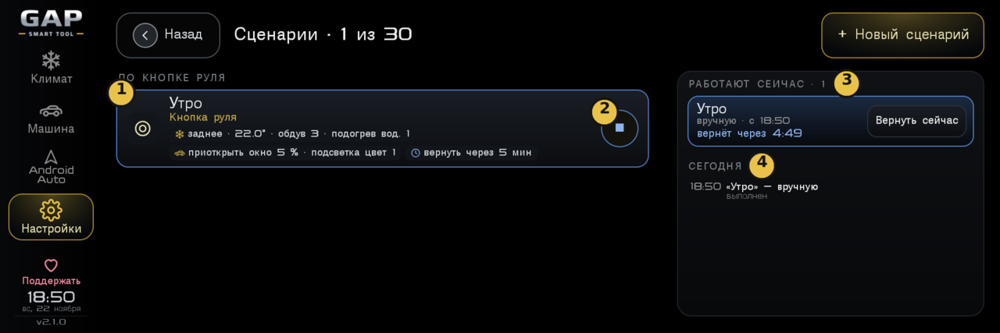

1. **Список сценариев** — по разделам: «По зажиганию», «По кнопке руля», «Вручную». В строке — когда сценарий
   срабатывает и что делает. Нажмите на строку — откроется сценарий. У сценариев по зажиганию в строке есть
   выключатель: он отключает запуск по зажиганию, не удаляя сценарий (вручную и голосом он запускается и так).
2. **▶** — запустить сейчас. Пока сценарий ждёт, чтобы вернуть как было, вместо ▶ стоит **■**: нажатие вернёт всё
   сразу.
3. **«Работают сейчас»** — что сценарии ещё вернут как было и когда. **«Вернуть сейчас»** — вернуть, не дожидаясь.
4. **«Сегодня»** — какие сценарии сегодня срабатывали и чем кончилось.

**«+ Новый сценарий»** вверху справа — создать сценарий.

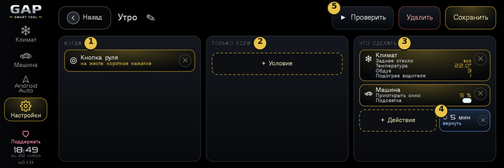

1. **Когда** — «Кнопка руля» (сам жест назначается в «Кнопке руля»), «Включили зажигание», «Выключили зажигание» или
   «Только вручную» (кнопкой ▶ в списке или голосом: «запусти сценарий утро»).
2. **Только если** — по желанию: время (с — до), дни недели, подключён выбранный телефон (по Bluetooth), селектор
   в P. Сценарий сработает, только если всё выполнено. При включении зажигания сценарий с условием «Подключён
   телефон» ждёт телефон до минуты.
3. **Что сделать** — **«+ Действие»**, три вкладки:
   - **Климат** — климат вкл/выкл, AUTO, A/C, рециркуляция, обдув лобового, заднее стекло, форсунки, температура,
     скорость обдува, подогревы и вентиляция;
   - **Машина** — старт-стоп, закрыть окна, проветрить, приоткрыть окно водителя (5–30 %), подсветка, тема
     приборки. «Проветрить» работает только в P, поэтому сценарию по кнопке или вручную с ним нужно условие
     «Селектор в P»;
   - **Мультимедиа** — профиль звука, Wi-Fi, Bluetooth, Android Auto и открыть приложение — любое, в том числе
     сам GAP.

   Всё, чего вы не коснулись, остаётся «не менять».
4. **Вернуть как было** — по желанию: **через время** (от 1 до 60 минут) или, у сценариев по кнопке и вручную,
   **повторным вызовом** (тем же жестом, ▶ или голосом). Вернётся только то, что поменял сценарий. Не вернётся то,
   что вы потом поменяли руками или поменял другой сценарий, а также закрытые окна, Android Auto и открытое
   приложение. Окна обратно открываются только в P. Выключили зажигание — возврат отменяется (подогревы машина
   гасит сама).
5. **«Проверить»** — выполнить действия сценария прямо сейчас и посмотреть, что получилось. Условия «Только если» и
   возврат при проверке не работают, Android Auto и приложение не открываются. **«Сохранить»** — сохранить,
   **«Удалить»** — удалить. Название меняется нажатием на ✎.

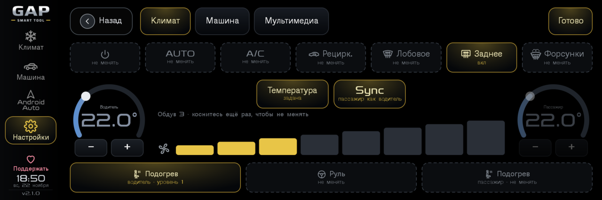

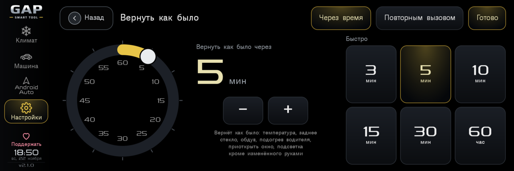

Полезно знать:

- **Противоречия приложение ловит само** — например, подогрев и вентиляция одного сиденья, «климат выкл» вместе с
  его настройками, два сценария по зажиганию, которые сработают одновременно и сделают противоположное. Оно
  подскажет, что не так, ещё до сохранения.
- **Открывать GAP при включении зажигания** — это сценарий: «Включили зажигание» → «Мультимедиа» → «Открыть
  приложение» → GAP Smart Tool.
- **Подогрев руля при каждом запуске** — тоже сценарий: «Включили зажигание» → «Климат» → «Руль».
- Сработал сценарий при включении зажигания — сверху появится плашка «Сработал …» с кнопкой «Отменить», если есть
  что вернуть.
- Сценарии запускаете только вы или зажигание. То, что сделал сам GAP, сценарии не запускает.

### Голос

**Как сказать команду.** Говорите после сигнала (если звуки выключены — когда появится плашка «Слушаю…»),
коротко: «подогрев руля», «обдув на три», «мне холодно». Интернет не нужен — речь распознаётся прямо в машине.

- Голосовая команда на **удержании** (так по умолчанию): держите пустую кнопку, после сигнала говорите, договорили —
  отпустите. Отпустили до сигнала — запись отменяется.
- Голосовая команда на **коротком или двойном** нажатии: нажмите, после сигнала говорите, договорили — нажмите
  кнопку ещё раз. Не нажали — запись закончится сама через 15 секунд.

Пока приложение слушает и отвечает, музыка становится тише — так же, как под подсказку навигатора. Насколько тише —
задаёт штатная настройка звука навигации в машине.

- **Подтверждать** — когда переспрашивать: «Если не уверен» (лучше всего), «Всегда» или «Только важные». Важные
  команды (выключить климат, включить рециркуляцию, выключить все подогревы и т. п.) при сомнении переспрашиваются в любом режиме, а
  открыть или закрыть багажник — всегда. Ответить можно и голосом: удержите кнопку и скажите «да» или «нет» (если на удержание
  назначена голосовая команда).
- **Отвечать голосом** — «Вопросы и ответы», «Только вопросы» или выключено (только звуки). При «Вопросы и ответы»
  приложение вслух говорит и чем кончился сценарий («Сценарий выполнен», «Вернул как было»), и почему ничего не
  сделано («Сценарий не назначен», «Голос ещё загружается»).
- **Звуки** — сигналы приложения (ниже).
- **Распознавание** — какая модель слушает речь (ниже). После включения ГУ модель загружается от 10 до 25 секунд,
  плитка в это время пишет «загружается…».
- **Примеры команд** — что можно сказать, по темам.
- **Открывать приложения** — «запусти приложение навигатор», «запусти приложение ютуб». По умолчанию выключено.
  Говорите обязательно со словом «приложение». Короткие иностранные названия (2ГИС, Waze) распознаются хуже — их
  лучше открывать с экрана.

Темы: температура, обдув и стёкла, климат, подогревы, подсветка и приборка, окна и багажник, по ощущениям
(«мне холодно», «душно», «запотело лобовое»), сценарии («запусти сценарий утро»), ответы и отмена. Порядок слов
и падежи — любые; только запуск сценария и приложения начинайте со слова «запусти».

**«Отмена»** или **«верни обратно»** после команды — вернуть как было. Багажник так не вернуть, а окна обратно
открываются только на стоянке (P). Сценарий «отменой» не вернуть — для него ■ или повторный вызов.

Цвет подсветки можно назвать просто («пурпурный») или со словом «подсветка» («подсветка синяя») — так надёжнее. Если цвет не
расслышан, приложение переспросит, а не выключит подсветку.

#### Звуки

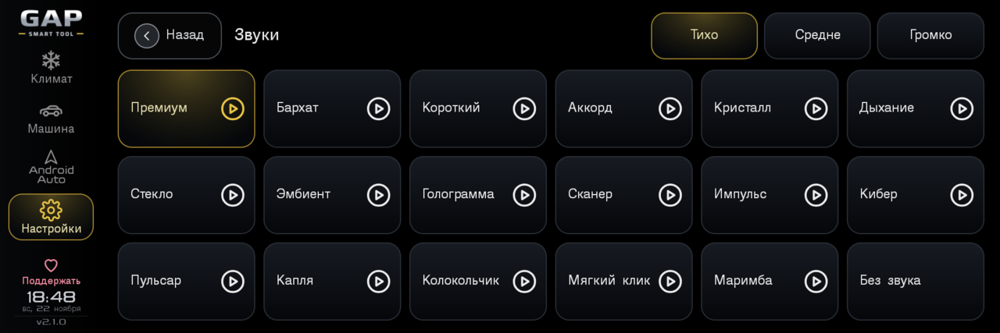

17 наборов сигналов и «Без звука». Нажмите на набор — он выберется и прозвучит; ▶ — только послушать. Вверху —
громкость: тихо, средне или громко. Сигналы и ответы звучат от громкости музыки, а «тихо — громко» меняет только сигналы. Пока голос говорит или слушает,
кнопки громкости показывают плашку «导航音量» (громкость навигации) — на голос и музыку она не влияет.

#### Модели распознавания

| | Vosk | Vosk+ | GigaAM |
|---|---|---|---|
| Точность | ошибается чаще | точнее | самая точная |
| Ответ после фразы | сразу, текст виден по ходу речи | около 1 с | 2–5 с |
| Загрузка при выборе и при запуске ГУ | около 20 с | около 25 с | около 10 с |
| Память ГУ | меньше всех | больше | больше всех |
| Где взять | встроена | архив моделей, см. [INSTALL.md](INSTALL.md#модели-распознавания-по-желанию) | то же |

- **В памяти — только выбранная модель.** Выбрали другую — прежняя выгружается, новая загружается.
- **Пока модель загружается**, у неё крутится значок, а остальные плитки бледные — другую не выбрать. Загрузилась —
  сверху плашка и голос «Распознавание готово» (при выключенных голосовых ответах — сигнал).
- **С Vosk на Vosk+ или GigaAM** — пока новая загружается, слушает Vosk. **Между Vosk+ и GigaAM или обратно на
  Vosk** — на время загрузки голос не отвечает: «Голос переключается на другую модель — подождите».
- **С Vosk+ и GigaAM** во время речи на плашке «Слушаю…» без текста — фраза разбирается целиком, когда вы её
  закончите («Распознаю…»).
- **Модели нет в машине** — её плитка бледная с подсказкой «положите модель на флешку установки». Если модель не
  загрузилась (не хватило памяти, сбой), приложение само перейдёт на Vosk и напишет об этом.
- Совет: **Vosk+** точнее Vosk и почти так же быстр. GigaAM — когда точность важнее скорости ответа.

#### Переспрос

Если команда понята неуверенно (и так велит настройка «Подтверждать»), сверху появится вопрос — как на картинке с
багажником выше:

- **Да** — нажмите кнопку руля один раз, нажмите на экране или удержите кнопку и скажите «да».
- **Нет** — нажмите кнопку руля два раза, нажмите на экране или удержите кнопку и скажите «нет».
- Полоска внизу — 8 секунд. Не ответили — команда отменяется.
- Пока висит вопрос, кнопка руля только отвечает — своё действие не выполняет.

### Звук

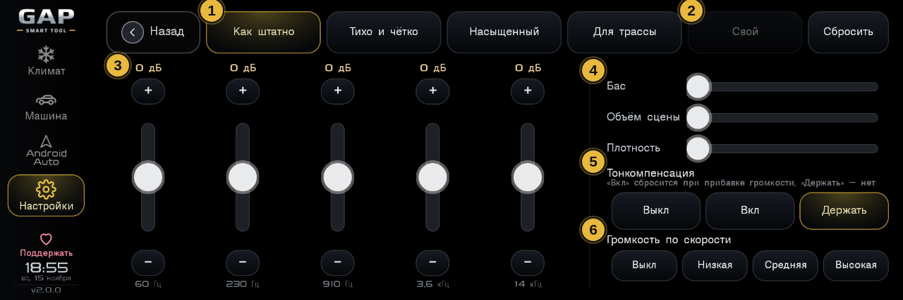

1. **Профиль** — «Как штатно» (бас, сцена, плотность и эквалайзер выключены), «Тихо и чётко», «Насыщенный» или
   «Для трассы». Выбранный профиль светится.
2. **«Свой»** загорается, когда настройки не совпадают ни с одним профилем. **«Сбросить»** — звук как штатно и
   тонкомпенсация выключена.
3. **Эквалайзер** — 5 полос от низких к высоким, ±6 дБ: «+» и «−» или ползунок.
4. **Бас, объём сцены, плотность** — ползунками. «Плотность» делает тихие места громче, а звук — плотнее.
5. **Тонкомпенсация** — полнее звук на тихой громкости. Работает в самом усилителе, для всех источников, включая
   радио. Три кнопки:
   - **«Выкл»**.
   - **«Вкл»** — включить. Усилитель машины сам выключает тонкомпенсацию, когда прибавляют громкость, — так устроена
     прошивка. Поэтому после прибавки кнопка переключится на «Выкл», чтобы не казалось, что тонкомпенсация ещё
     работает.
   - **«Держать»** — после каждой смены громкости приложение снова включает тонкомпенсацию. В момент смены громкости
     может быть слышен короткий перепад звука, около секунды.
6. **Громкость по скорости** — выкл, низкая, средняя или высокая: насколько машина прибавляет звук с ростом
   скорости. Это та же настройка, что в штатных настройках звука.

Бас, сцена, плотность и эквалайзер действуют на звук, который идёт через Android (музыка по Bluetooth, с флешки, из
приложений), на радио — нет. Они работают и при закрытом приложении. «Как штатно» выключает их, а тонкомпенсацию и
громкость по скорости не трогает.

### Комплектация

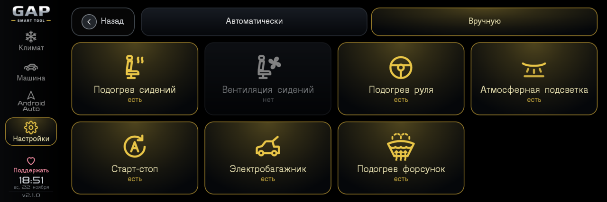

Что есть в машине: подогрев и вентиляция сидений, подогрев руля, атмосферная подсветка, старт-стоп,
электробагажник, подогрев форсунок.

- **«Автоматически»** — приложение берёт это из заводских настроек ГУ.
- **«Вручную»** — если определилось неверно. Нажмите на плитку — она переключится, и приложение перейдёт на
  «Вручную».

Чего нет, то приложение прячет и не включает: ни с экрана, ни кнопкой руля, ни голосом, ни сценарием.

### Wi-Fi

Подключить машину к интернету с телефона без штатных настроек Android: раздайте интернет с телефона и выберите сеть.

- Сверху — Wi-Fi вкл/выкл и **«При запуске ГУ»**: «Не трогать», «Помнить последнее» (по умолчанию) или «Всегда
  включать». Прошивка ГУ при запуске иногда оставляет Wi-Fi выключенным — приложение включит его и скажет об этом.

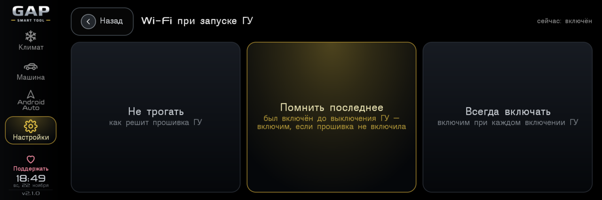

- Связь держится сама: пропала — приложение подключится к сохранённой сети, которая рядом (если вы сами не нажали
  «Отключиться» в GAP).
- Ниже — сети. Нажмите на сохранённую — «Подключиться», «Отключиться» или «Забыть сеть». Новая сеть с паролем
  (WPA/WPA2, как у точки доступа телефона) — своя крупная клавиатура, пароль вводится только на стоянке (P).

### Bluetooth

Телефон для звонков и музыки.

- Сверху — Bluetooth вкл/выкл и **«При запуске ГУ»**, как у Wi-Fi.
- Ниже — сопряжённые устройства. Нажмите на устройство — «Подключить» (или «Отключить») и «Забыть устройство».
  Звонки и музыка подключаются вместе.
- **«+ Новое устройство»** в конце списка — найти и сопрячь новый телефон. Только на стоянке (P).
- **Телефон подключится сам.** Если прошивка после включения ГУ не подключила телефон, GAP один раз подключит
  последний телефон. Подключился только для звонков — GAP подключит и музыку. Если вы сами отключили телефон в GAP,
  приложение до следующего включения ГУ его не трогает.
- **Музыка по Bluetooth — без штатного плеера.** Когда источник звука ГУ — Bluetooth, кнопки треков на руле листают
  музыку с телефона через несколько секунд после подключения, а GAP сам включает музыку так же, как штатный плеер:
  тонкомпенсация и эффекты звука работают и без захода в него. Радио, флешку и уже играющую музыку GAP не трогает.

### Приложение

- **Заставка на ходу** — закрывать экран выше 15 км/ч (см. [За рулём](#за-рулём)). Отключить можно только на
  стоянке, через предупреждение.
- **При запуске** — когда приложение запустилось, показать плашку «GAP Smart Tool готов» и сказать «Приложение
  готово» (голосом — если голосовые ответы не выключены).
- **Обновление** — версия приложения и обновление по воздуху (ниже).
- **Заводские настройки** — **«Вернуть»**: тема приборки — «по режиму вождения», тонкомпенсация — выключить,
  звук — «как штатно», старт-стоп — «не трогать». Подсветка остаётся как есть. Без связи с машиной ничего не
  меняется.
- **Удалить GAP** — удалить приложение прямо с экрана, без флешки. Только на стоянке (P). Приложение вернёт заводские
  настройки машины, потом Android спросит «Удалить приложение?» — после «ОК» удалит его со всеми файлами:
  настройками, журналами, моделями распознавания. Пока заводские возвращаются, экран закрыт чёрной заставкой
  «Возвращаем заводские настройки…» — не выключайте зажигание и не выходите из приложения. Нет связи с машиной —
  приложение предупредит, что заводские не вернутся, и предложит «Удалить без заводских».

Открывать GAP при включении зажигания — теперь [сценарием](#сценарии).

### Обновление

Нужен интернет — например, Wi-Fi с телефона. Раз в сутки приложение проверяет, нет ли новой версии. Нажмите на
плитку **«Обновление»** — проверит сейчас.

- Есть новая версия — на **«Настройках»** и **«Приложении»** загорится точка. Откройте **«Обновление»**:
  там «что нового» и **«Скачать»**.
- Скачивается и при закрытом приложении. Оборвалось (пропал интернет, выключили машину) — продолжится с того же
  места.
- Скачалось — на странице **«Обновление»** появится **«Установить»**. Если GAP закрыт, на стоянке сверху появится
  плашка «GAP Smart Tool … скачан» с той же кнопкой — поверх других приложений.
- Ставится только на стоянке (P) и только по нажатию **«Установить»** — штатным установщиком Android. В первый раз
  Android попросит разрешить «Неизвестные источники»: в подсказке GAP нажмите «Дальше» и включите их.
- Настройки и сценарии сохраняются. Файл обновления удаляется после установки.

### Диагностические данные

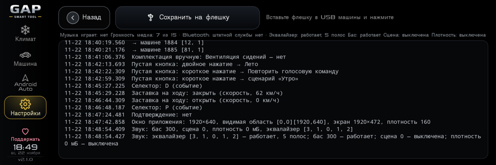

Если что-то работает не так: вставьте флешку, нажмите **«Сохранить на флешку»** и подождите пару секунд. Журнал
появится на флешке в папке `gaptool_…` — где именно, приложение покажет на экране (обычно
`Android/data/io.github.queryparams.gaptool/files/`). Приложите эту папку к обращению.

Под кнопкой — что сейчас со звуком: играет ли музыка, громкость, Bluetooth и какие эффекты работают. Ниже — лента
событий: что делало приложение и что отвечала машина.

Журнал хранится во внутренней памяти приложения — другие приложения его не читают. Наружу он попадает, только если
вы нажмёте эту кнопку или вставите флешку установки или удаления. В журнале есть текст распознанных команд, а
записи голоса приложение не сохраняет.

### Настройки Android

Штатные настройки системы ГУ, которые Geely прячет. Там можно нарушить работу ГУ — меняйте только то, в чём уверены.
Вернуться — значком GAP Smart Tool на рабочем столе.

### Дата и время

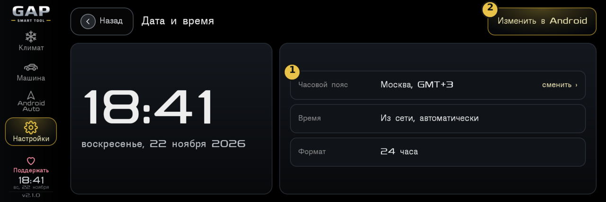

Слева — часы и дата ГУ. Справа — часовой пояс, откуда берётся время и формат часов. На плитке «Дата и время» в
«Настройках» тоже видны часы и пояс.

1. **Часовой пояс** — нажмите, откроется список: сверху все пояса России, ниже — города мира. В строке — смещение
   и сколько там сейчас времени. Нажмите на город — пояс сменится сразу.

   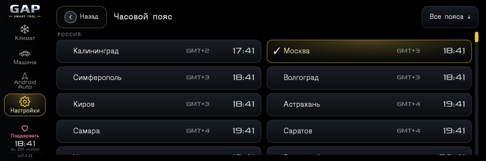

   **Как это работает.** Главные часы в машине — у приборной панели: ГУ подстраивает свои часы под неё. Поэтому
   GAP вместе с поясом отправляет приборке новое время и 5 секунд смотрит, приняла ли она его. Приборка принимает
   новое время только **один раз, пока машина не выключится полностью** — выключить и снова включить зажигание
   недостаточно. Не приняла — пояс вернётся прежним, и приложение скажет: «Сменить его можно после полного
   выключения машины». Так пояс и часы не расходятся.

   В старой базе поясов прошивки у некоторых городов неверное смещение (Саратов, Томск, Новосибирск, Волгоград
   и др.). Для них ставится пояс с правильным временем, а в списке показывается выбранный вами город.
2. **«Изменить в Android»** — время вручную, «из сети» и формат 12/24 меняются только в штатных настройках Android:
   кнопка откроет их (с тем же предупреждением, что и «Настройки Android»).

### Условия

Перечитать условия использования. **«Отозвать согласие»** справа вверху (нажать дважды — второй раз подтверждает) —
приложение перестанет управлять машиной.

---

## За рулём

Выше 15 км/ч экран управления закрывается, чтобы не отвлекаться (выключается в «Настройки» → «Приложение»):

Видны часы, дата и поездка: сколько в пути, сколько проехали, средняя скорость в движении. Касания ничего не
нажимают. Управлять — голосом, кнопкой руля и сценариями. Остановились полностью или селектор в **P** — экран снова
открыт.

- **Android Auto на ходу остаётся открытым**, если его картинка уже идёт: он сделан для езды. В меню на ходу
  нажимается только он.
- **Экран подключения Android Auto** на ходу закрыт заставкой — подключайте телефон на стоянке.

---

## Если что-то не так

- **Голос не слышит** — проверьте, что на нужный жест назначена «Голосовая команда» («Настройки» → «Кнопка руля»).
  Сразу после включения ГУ подождите, пока загрузится распознавание: на плитке «Распознавание» пропадёт
  «загружается…».
- **Голос часто ошибается** — поставьте модель Vosk+ или GigaAM («Настройки» → «Голос» → «Распознавание»).
- **Сценарий не сработал** — посмотрите «Сегодня» на странице сценариев: там видно, срабатывал ли он и чем кончилось.
  Проверьте условия «Только если» и выключатель у сценариев по зажиганию.
- **Часовой пояс вернулся обратно** — прочитайте плашку. «Приборка не приняла время» — она уже приняла новое время
  и до полного выключения машины другое не примет: выберите пояс снова после полного выключения машины. «Часы ГУ ещё не
  выставлены» или «Нет связи с приборкой» — попробуйте чуть позже.
- **Android Auto мигает или подтормаживает** — обновите OvertakeLink до 1.3.0 или новее и выключите на телефоне
  поиск сетей Wi-Fi (см. [Android Auto](#android-auto)).
- **Всё бледное, «нет связи»** — приложение не получает данных от машины. Если через минуту не прошло само —
  сохраните журнал и напишите в Issues.
- **Ничего не работает** — откройте приложение: возможно, не приняты условия использования (если после обновления
  они изменились, их нужно принять заново) или прошивка ГУ не та — тогда приложение покажет это.
- **Не помогло** — сохраните журнал на флешку и откройте обращение в [Issues](../../issues/new/choose).

**GAP Smart Tool бесплатный.** Скачивать — только здесь, в [Releases](../../releases). Если вам установили его за
деньги — вы платили за работу установщика, а не за приложение.
