# Как пользоваться GAP Smart Tool

Коротко: всё, что умеет приложение, и куда нажимать. Установка — в [INSTALL.md](INSTALL.md).

**Главное.** Приложение работает в фоне с каждого включения машины. Кнопка руля и голос работают всегда —
открывать приложение нужно только чтобы что-то настроить или нажать на экране.

- [Первое открытие](#первое-открытие)
- [Климат](#климат)
- [Кнопка руля](#кнопка-руля)
- [Голос](#голос)
- [Звук](#звук)
- [Авто: подсветка, тема, старт-стоп](#авто-подсветка-тема-старт-стоп)
- [За рулём](#за-рулём)
- [Журнал](#журнал)
- [Если что-то не так](#если-что-то-не-так)

---

## Первое открытие

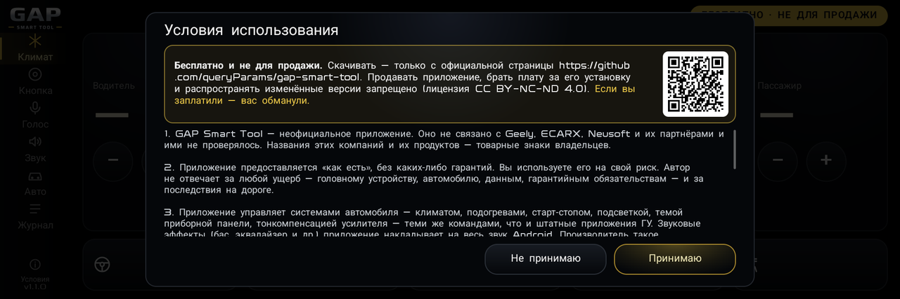

После заставки — условия использования. Прочитайте и нажмите **«Принимаю»**.

- **«Не принимаю»** — приложение не будет управлять машиной. Передумаете — откройте приложение снова.
- Перечитать условия или отозвать согласие — **«Условия»** внизу меню слева.

---

## Климат

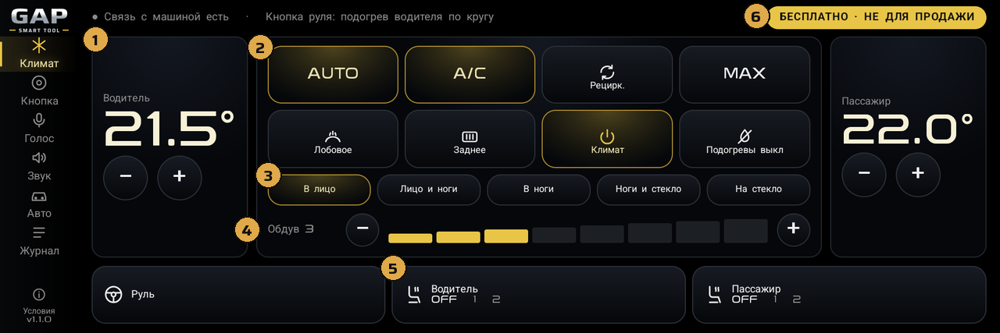

1. **Температура водителя** — «−» и «+», шаг 0,5°. Справа — то же для пассажира.
2. **Кнопки климата** — AUTO, A/C, рециркуляция, MAX, обдув лобового, обогрев заднего стекла (зеркала греются
   вместе с ним), климат вкл/выкл, «Подогревы выкл» — выключить все подогревы разом.
3. **Направление обдува** — в лицо, лицо и ноги, ноги, ноги и стекло, на стекло.
4. **Скорость обдува** — «−» и «+» или нажать на нужное деление.
5. **Подогревы** — руль: вкл/выкл; сиденье водителя и пассажира: каждое нажатие — следующий уровень
   (выкл → 1 → 2 → выкл).
6. **«Бесплатно · не для продажи»** — нажмите, чтобы узнать подробности. Если за приложение взяли деньги — вас
   обманули.

Горящая золотом кнопка — включено. Всё, что включено, видно сразу: приложение читает состояние машины.

---

## Кнопка руля

Пустая кнопка на руле получает три действия: **короткое нажатие**, **двойное** и **удержание**.

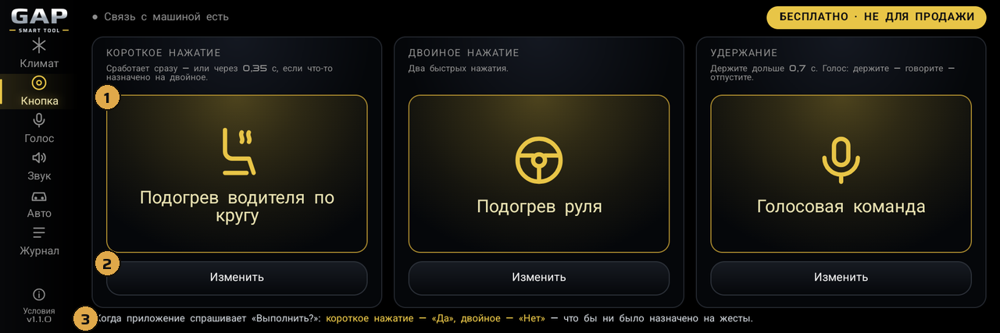

1. Что сейчас назначено на жест.
2. **«Изменить»** — выбрать другое действие (ниже).
3. **Когда приложение спрашивает «Выполнить?»**, кнопка только отвечает: короткое нажатие — «Да», двойное — «Нет».
   Назначенное действие в этот момент не срабатывает.

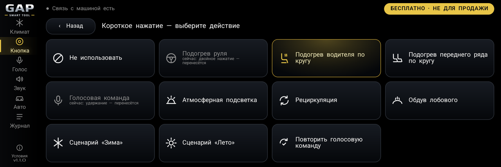

Подогрев руля, подогрев водителя или всего переднего ряда по кругу, **голосовая команда**, подсветка,
рециркуляция, обдув лобового, сценарии «Зима» и «Лето», повтор последней голосовой команды или «Не использовать».
Одно действие — на один жест: если выбрать уже занятое, оно перенесётся.

- **«Зима»** — подогрев руля, сиденье водителя на 2, обдув лобового и обогрев заднего стекла.
- **«Лето»** — кондиционер.

---

## Голос

**Как сказать команду.** Нажмите жест, на который назначена «Голосовая команда» (по умолчанию — **удержание**
пустой кнопки), дождитесь сигнала и скажите коротко: «подогрев руля», «обдув на три», «мне холодно».
Интернет не нужен — речь распознаётся прямо в машине.

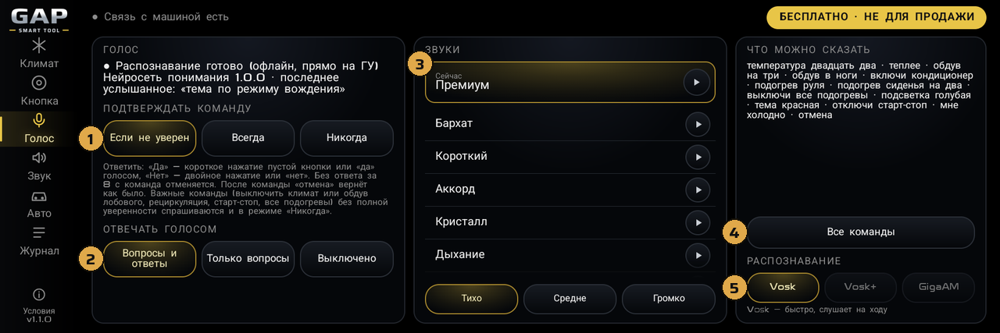

1. **Подтверждать команду** — когда переспрашивать «Выполнить?»: если не уверен (лучше всего), всегда или никогда.
2. **Отвечать голосом** — вопросы и ответы, только вопросы или молча.
3. **Звуки** — сигналы приложения: выберите строку — звук сразу проиграется; ▶ — только послушать. Ниже громкость.
4. **«Все команды»** — полный список, что можно сказать (ниже).
5. **Распознавание** — какая модель слушает речь (подробнее — ниже, «Модели распознавания»).

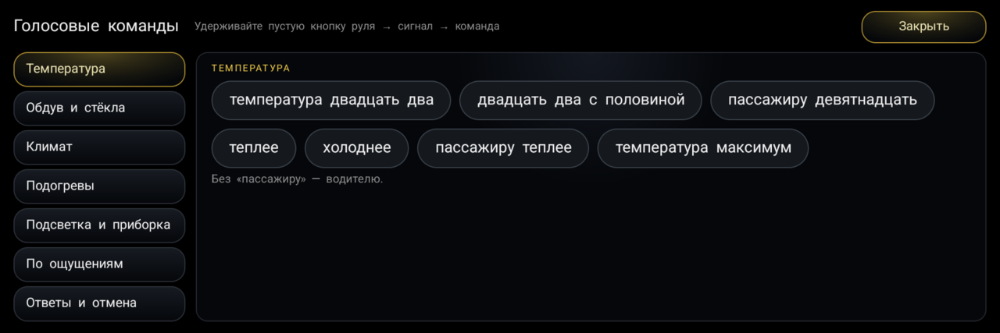

### Модели распознавания

| | Vosk | Vosk+ | GigaAM |
|---|---|---|---|
| Точность | ошибается чаще | точнее | самая точная |
| Ответ после фразы | сразу, текст виден по ходу речи | около 1 с | 2–5 с |
| Загрузка при выборе и при запуске ГУ | около 20 с | около 25 с | около 10 с |
| Память ГУ | меньше всех | больше | больше всех |
| Где взять | встроена | архив моделей, см. [INSTALL.md](INSTALL.md#модели-распознавания-по-желанию) | то же |

- **В памяти — только выбранная модель.** Переключились — прежняя выгружается, новая загружается.
- **С Vosk на Vosk+ или GigaAM** — пока новая загружается, слушает Vosk. **Между Vosk+ и GigaAM или обратно на
  Vosk** — на время загрузки голос не отвечает: «Голос переключается на другую модель — подождите».
- **Пока модель загружается, другую не выбрать** — кнопки бледные, загрузка дойдёт до конца.
- **С Vosk+ и GigaAM** во время речи на плашке «Слушаю…» без текста — фраза разбирается целиком, когда вы её
  закончите («Распознаю…»).
- **Модели нет в машине** — её кнопка бледная. Не загрузилась (не хватило памяти, сбой) — приложение само перейдёт на
  Vosk и напишет об этом под кнопками.
- Совет: **Vosk+** — точнее Vosk и почти так же быстро. GigaAM — когда точность важнее скорости ответа.

### Переспрос

Если команда понята неуверенно, сверху появится вопрос:

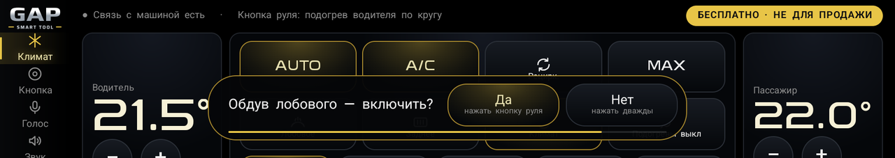

- **Да** — нажмите кнопку руля один раз, скажите «да» или нажмите на экране.
- **Нет** — нажмите кнопку руля два раза, скажите «нет» или нажмите на экране.
- Полоска внизу — 8 секунд; не ответили — команда отменяется.
- Пока висит вопрос, кнопка руля только отвечает — своё действие не выполняет.

**«Отмена»** или **«верни обратно»** после команды — вернуть как было.

Цвет подсветки называйте вместе со словом «подсветка»: «подсветка синяя», «цвет подсветки пурпурный». Если цвет не
расслышан, приложение переспросит, а не выключит подсветку.

---

## Звук

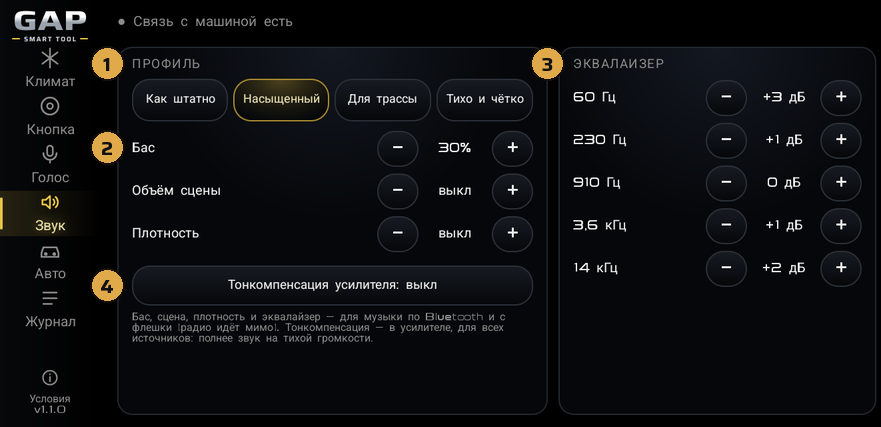

1. **Профиль** — «Как штатно» (всё выключено), «Насыщенный», «Для трассы» или «Тихо и чётко». Выбранный
   профиль светится; поменяли что-то вручную — подсветка профиля гаснет.
2. **Бас, объём сцены, плотность** — кнопками **−** и **+**, шаг 10 %. «Плотность» делает тихие места
   громче, звук — плотнее.
3. **Эквалайзер** — 5 полос, от низких к высоким, ±6 дБ.
4. **Тонкомпенсация усилителя** — полнее звук на тихой громкости. Работает в самом усилителе, для всех
   источников, включая радио.

Справа от эквалайзера на экране (на картинке не показаны) — **метрики**: что сейчас играет, подключён ли телефон
по Bluetooth, какие эффекты работают, что выставлено в штатном эквалайзере усилителя.

Бас, сцена, плотность и эквалайзер действуют на музыку по Bluetooth и с флешки, на радио — нет. Они работают и
при закрытом приложении; «Как штатно» возвращает звук как с завода.

---

## Авто: подсветка, тема, старт-стоп

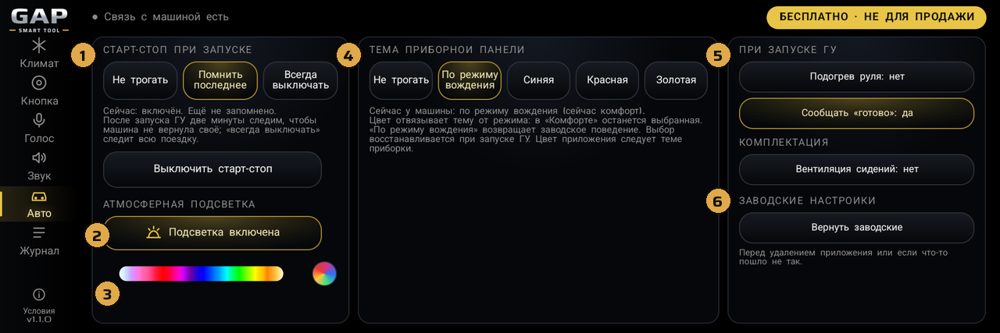

1. **Старт-стоп при запуске** — «Не трогать», «Помнить последнее» (вернёт, как вы оставили) или «Всегда
   выключать». Кнопка ниже — выключить или включить сейчас.
2. **Атмосферная подсветка** — включить или выключить.
3. **Цвет подсветки** — ведите пальцем по полосе, отпустите — цвет применится. Радужный кружок справа — цвет по
   режиму вождения. Яркость — в штатных настройках машины.
4. **Тема приборной панели** — синяя, красная, золотая или «по режиму вождения» (как с завода). Цвет приложения
   следует теме, а при «по режиму вождения» — режиму: комфорт — золотой, эко — синий, спорт — красный.
5. **При запуске ГУ** — **«Подогрев руля»**: включать ли его при каждом запуске; **«Сообщать «готово»»** — сказать,
   когда приложение запустилось.
6. **Заводские настройки** — **«Вернуть заводские»**: тема приборки — «по режиму вождения», тонкомпенсация
   усилителя — выключить, звук — «как штатно», старт-стоп — «не трогать». Подсветка остаётся как есть. Нажмите
   перед удалением приложения или если что-то пошло не так; без связи с машиной ничего не меняется.

---

## За рулём

Пока селектор не в **P**, экран управления закрыт — чтобы не отвлекаться:

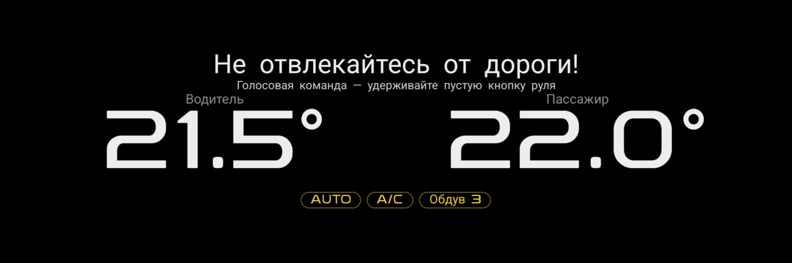

Видно температуру и что включено. Управлять — голосом и кнопкой руля. Селектор в **P** — экран снова открыт.

---

## Журнал

1. **«Сохранить журнал на флешку»** — если что-то работает не так: вставьте флешку, нажмите, подождите пару
   секунд и выньте. На флешке появится папка `gaptool_…` — приложите её к обращению.

---

## Если что-то не так

- **Голос не слышит** — проверьте, что на нужный жест назначена «Голосовая команда» (страница «Кнопка»).
- **Голос часто ошибается** — поставьте модель Vosk+ или GigaAM («Голос» → «Распознавание»).
- **Ничего не работает** — откройте приложение: возможно, не приняты условия использования (после обновления
  их нужно принять заново, если они изменились) или прошивка ГУ не та — тогда приложение покажет это.
- **Не помогло** — сохраните журнал на флешку и откройте обращение в [Issues](../../issues/new/choose).

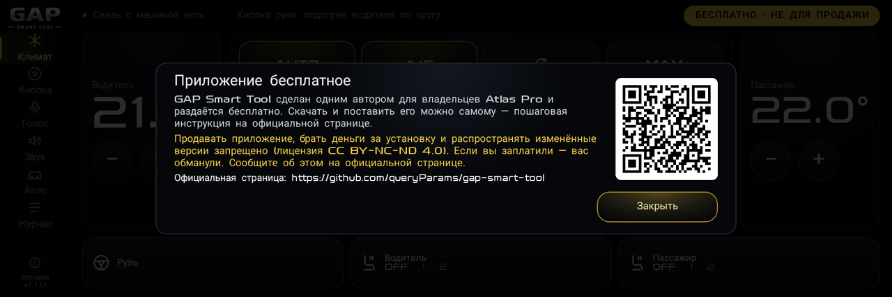

**GAP Smart Tool бесплатный.** Скачивать — только здесь, в [Releases](../../releases). Если вы заплатили за
приложение или за установку — вас обманули.
